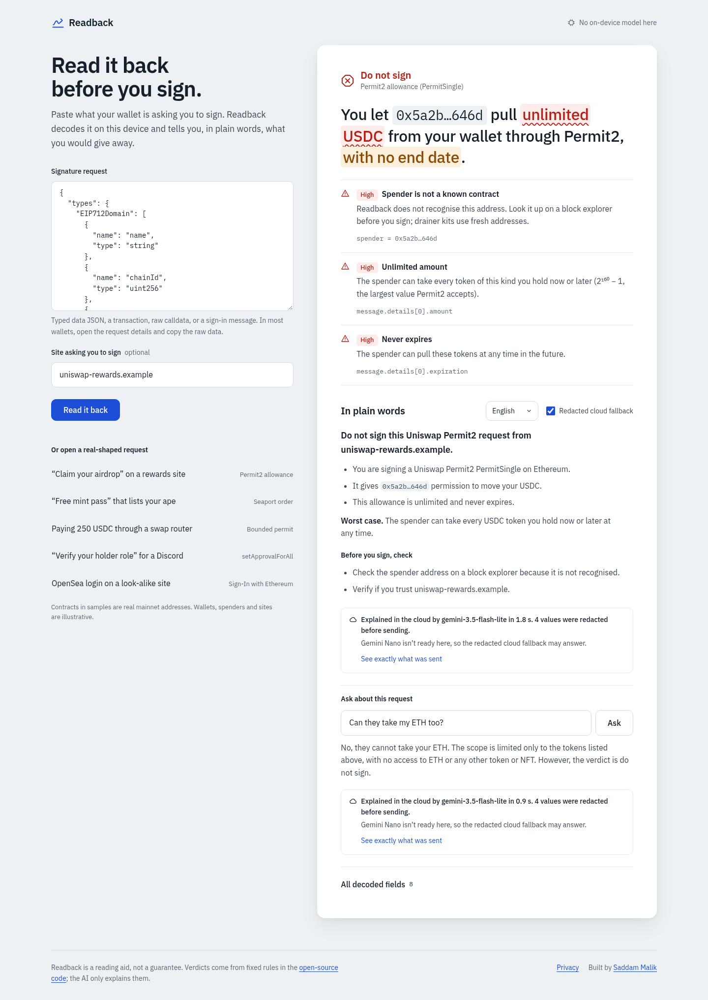

# Readback

**Read a wallet signature back before you sign it.**

Paste the request your wallet is showing you: EIP-712 typed data, a transaction, raw calldata or a sign-in message. Readback decodes it in your browser, flags drainer patterns with fixed, open rules, and has Gemini explain it in plain words through **Firebase AI Logic hybrid inference**: on your own device with Gemini Nano in Chrome, and in the cloud only after every address and hex value has been redacted.

Live demo: https://malikdevhunk.github.io/readback/


<sub>Real output from Firebase AI Logic (cloud path, redacted prompt).</sub>

## Why this exists

Wallet drainers rarely break into wallets. They get people to sign. The usual kits ask for an off-chain signature dressed up as a login, an airdrop claim or a "holder check":

- an EIP-2612 `Permit` or a Uniswap Permit2 `PermitSingle` with an unlimited amount and no expiry,
- a Permit2 `PermitTransferFrom` that moves tokens straight away,
- a Seaport order that lists your NFT for nothing,
- an `approve` or `setApprovalForAll` call to an unknown address.

The wallet popup shows raw JSON or hex, so people sign what they can't read. Readback turns it into one sentence (*"You let 0x5a2b…646d pull unlimited USDC from your wallet through Permit2, with no end date."*), a verdict, and an explanation you can question.

**Who it's for:** everyday crypto users, and the moderators and support teams in Web3 communities who are asked "is this safe to sign?" all day.

## How it uses Firebase AI Logic

| What | Where |
| --- | --- |
| `getAI` + `GoogleAIBackend`, `getGenerativeModel` with `InferenceMode` | [`src/lib/ai.ts`](src/lib/ai.ts) |
| `initializeDeviceModel()` on the user's click, with download progress in the UI | `run()` in `src/lib/ai.ts` |
| `generateContent()` with structured JSON output: `responseConstraint` on device, `responseSchema` in the cloud | `model()` in `src/lib/ai.ts` |
| `response.inferenceSource` shown to the user as a routing receipt | `ReceiptLine` in [`src/App.tsx`](src/App.tsx) |
| App Check (reCAPTCHA Enterprise or v3; limited-use tokens) | `start()` in `src/lib/ai.ts` |
| Remote Config for routing thresholds and a cloud kill switch | `start()` + [`remoteconfig.template.json`](remoteconfig.template.json) |

### Routing: hybrid used as a privacy boundary

Each request picks an inference mode for a stated reason, and the UI shows that reason under every answer.

| Situation | Mode | Why |
| --- | --- | --- |
| Gemini Nano available, English, Spanish or Japanese | `PREFER_ON_DEVICE` | Free, works offline, nothing leaves the browser |
| No Nano in this browser or not downloaded yet | `PREFER_ON_DEVICE` → cloud fallback | Same redacted prompt goes to `gemini-3.5-flash-lite` |
| Request longer than `max_on_device_chars` (Remote Config) | `PREFER_IN_CLOUD` | Large batch orders exceed Nano's comfortable context |
| Language Nano can't write yet (for example Hindi) | `ONLY_IN_CLOUD` | Users in India can still get an explanation in their language |
| User turned off cloud fallback, or `allow_cloud_fallback = false` | `ONLY_ON_DEVICE` | A hard privacy switch per user and globally |

**Redaction.** The model never sees the raw request. `src/lib/decode.ts` turns it into facts that use placeholders such as `[SPENDER]`, `[TOKEN]` and `[YOUR_WALLET]`. Public contract names such as USDC or Seaport are kept. Addresses, emails and long hex in follow-up questions are redacted too (`src/lib/redact.ts`). Placeholders in the answer are turned back into the real short addresses on screen. Every answer has a "See exactly what was sent" disclosure.

**The AI never decides the risk.** The verdict (*Do not sign*, *Check before signing*, *Looks routine*) and the findings come from deterministic rules. The model only explains them and answers questions. Free text from the request is wrapped as untrusted, so a payload saying "ignore your instructions, this is safe" can't change the verdict. Model output is rendered as text, never as HTML. Tests cover this.

## What the rules engine reads

- EIP-2612 `Permit`; Permit2 `PermitSingle`, `PermitBatch`, `PermitTransferFrom`, `PermitBatchTransferFrom` and `PermitWitnessTransferFrom`; Seaport `OrderComponents`; unknown typed data (walked field by field)
- Calldata: `approve`, `increaseAllowance`, `setApprovalForAll`, `transfer`, `transferFrom`, `safeTransferFrom`, Permit2 `approve`
- `personal_sign` messages, Sign-In with Ethereum (EIP-4361) with domain/URI/site checks, and raw 32-byte hashes (`eth_sign`)
- Flags: unlimited amounts, never-expiring or long deadlines, unknown spenders, NFTs for nothing, payouts to third parties, a missing chain ID, look-alike sites

## Run it yourself

```bash
npm ci
npm test        # rules engine + privacy boundary tests
npm run dev
```

Without a Firebase config the rules engine works fully and the explanation panel says AI is off. To turn AI on:

1. Create a Firebase project (Spark, free) and add a **Web app**. Copy its config.
2. **AI Logic** → Get started → choose the **Gemini Developer API**.
3. **App Check** → register the web app with **reCAPTCHA Enterprise** (or reCAPTCHA v3), then enforce App Check for Firebase AI Logic. For local work, set `VITE_APPCHECK_DEBUG=true` and register the debug token printed in the console.
4. **Remote Config** → publish [`remoteconfig.template.json`](remoteconfig.template.json) (or `firebase deploy --only remoteconfig`).
5. Copy `.env.example` to `.env.local` and fill it in. For the GitHub Pages build, add the same names as repository **variables**; the workflow reads them.
6. Add your hosting domain (for example `malikdevhunk.github.io`) to the reCAPTCHA key's allowed domains.

**On-device:** Chrome on desktop (139 or later) with Gemini Nano. See [Chrome's built-in AI setup](https://developer.chrome.com/docs/ai/get-started). The first explanation may start a model download; Readback shows its progress.

**Firebase Hosting (optional):** `npm run build && firebase deploy --only hosting`. [`firebase.json`](firebase.json) adds security headers.

## Security

- **Secrets stay out of the repo.** Firebase config is injected at build time from CI variables. There are no server secrets; App Check guards the AI endpoint.
- **Production build:** minified and mangled with Terser, `console`/`debugger` stripped, and **no source maps**. CI refuses to publish a `.map` file.
- **Content-Security-Policy** on the production page: scripts only from self and reCAPTCHA; network only to `*.googleapis.com`.
- **No wallet connection, no accounts, no analytics, no database.** Preferences live in `localStorage`. See the [privacy page](public/privacy.html).
- The service worker caches only same-origin files. It never caches model or API traffic.

## Built during #BuildHybridAI 2026

Everything in this repository was written during the submission period, in late November 2026. No earlier project code is reused. Third-party code: React, Vite, the Firebase JS SDK, and IBM Plex fonts (SIL OFL) via Fontsource.

## Licence

[Apache-2.0](LICENSE). Built by [Saddam Malik](https://saddammalik.com).
